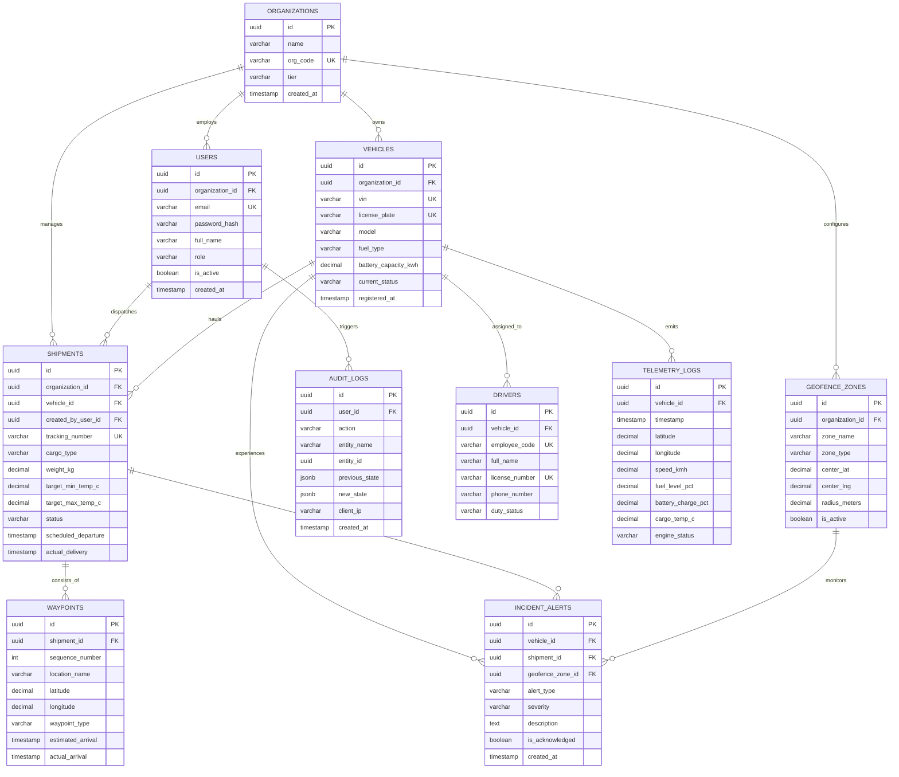

# Entity Relationship Diagram (ERD) & Database Normalization Specification
## Project ApexTrack Enterprise: Relational Schema Architecture
**Document Version:** 2.4.0  
**Phase:** Phase 2 (P0 Capstone Deliverable)  
**Author:** Himesh Singh (PDIT-FTE-11462), Lead Systems Architect  
**Reviewer:** Amit Sharma (Senior Staff Engineer, Prodesk IT)  

---

## 1. Visual Entity Relationship Diagram (ERD)



---

## 2. Mathematical Normalization Protocols & Proofs

To eliminate redundant storage anomalies, ensure data integrity under concurrent transactions, and protect against update/delete anomalies, the database schema strictly adheres to **Third Normal Form (3NF)**.

### 2.1. First Normal Form (1NF) Proof
* **Criteria:**
  1. Each table has a designated, unique primary key (UUID v4 surrogate keys).
  2. All attribute fields store strictly atomic (indivisible) scalar values. No repeating groups or multi-valued delimited strings (e.g. Waypoint lat/long and sequences are normalized into discrete rows rather than stored as comma-separated arrays in `SHIPMENTS`).
  3. Every column contains values of a single uniform domain and type.
* **Verification:**
  - `WAYPOINTS` stores single coordinates (`latitude`, `longitude`) with a deterministic `sequence_number`.
  - Telemetry sensor readings are separated into individual discrete tuples rather than packed strings.

### 2.2. Second Normal Form (2NF) Proof
* **Criteria:**
  1. All requirements of 1NF are completely satisfied.
  2. Every non-prime attribute is fully functionally dependent on the entire primary key, eliminating partial functional dependencies on composite candidate keys.
* **Verification:**
  - In legacy designs, a composite key table like `(shipment_id, vehicle_vin, driver_license)` created partial dependencies where `vehicle_model` depended solely on `vehicle_vin`, not `shipment_id`.
  - In ApexTrack, composite keys are replaced by single surrogate primary keys (`id UUID`), and all vehicle attributes (`model`, `fuel_type`, `battery_capacity_kwh`) reside strictly in `VEHICLES`, where they depend exclusively on `VEHICLES.id`.
  - $f: \text{VEHICLES.id} \longrightarrow \{\text{vin}, \text{license\_plate}, \text{model}, \text{fuel\_type}\}$. No partial dependency exists.

### 2.3. Third Normal Form (3NF) Proof
* **Criteria:**
  1. All requirements of 2NF are completely satisfied.
  2. No non-prime attribute is transitively dependent on the primary key ($X \to Y$ and $Y \to Z$ where $X$ is the PK and $Z$ is non-prime is strictly prohibited).
* **Verification:**
  - **Identified Transitive Dependency in Draft Schema:** In an unnormalized draft, `SHIPMENTS` contained `(shipment_id, driver_id, driver_phone_number)`. Here, $\text{shipment\_id} \to \text{driver\_id}$ and $\text{driver\_id} \to \text{driver\_phone\_number}$. This caused a transitive dependency where changing a driver's phone number forced updates across thousands of historic shipment rows.
  - **Resolution to 3NF:** Decomposed into `DRIVERS` table. `SHIPMENTS` references only `vehicle_id`. The driver's contact details depend solely on `DRIVERS.id`.
  - Similarly, Organization Tier details (`tier_name`, `max_fleets`) are kept in `ORGANIZATIONS`, preventing transitive duplication inside `USERS` or `VEHICLES`.

---

## 3. UI/UX Wireframing & Design System Architecture

### 3.1. Design Tokens & Visual Hierarchy
* **Color Palette (Enterprise Slate & Cyber Cyan):**
  - Background (Surface 0): `#0b0f19` (Deep Obsidian)
  - Card & Container Surface: `#111827` (Card Dark Slate)
  - Interactive Accent / Primary: `#06b6d4` (Cyan 500)
  - Critical Alert Accent: `#ef4444` (Rose 500)
  - Warning / In-Transit Accent: `#f59e0b` (Amber 500)
  - Success / Normal State: `#10b981` (Emerald 500)
* **Typography:**
  - Display & Headings: `Inter`, sans-serif (700 Bold / 600 Semi-Bold)
  - Body & Form Controls: `Inter`, -apple-system, system-ui (400 Regular / 500 Medium)
  - Telemetry Data & Coordinates: `JetBrains Mono`, `Fira Code`, monospace
* **Layout Grid:** 12-column responsive fluid grid with 24px gutters on desktop, collapsible to 4-column single stack on mobile (< 640px).

### 3.2. Responsive Viewport Wireframes

#### Desktop Viewport (>= 1200px)
```
+---------------------------------------------------------------------------------------+
|  [LOGO] APEXTRACK ENTERPRISE   | Live Telemetry: ACTIVE | Org: NorthAmerica-East | Admin |
+---------------------------------------------------------------------------------------+
|  [Active Fleets: 1,420]  |  [In-Transit: 842]  |  [SLA Compliance: 99.8%]  | [Alerts: 3] |
+---------------------------------------------------+-----------------------------------+
|  REAL-TIME RADAR & TELEMETRY STREAM               |  ACTIVE SHIPMENT DISPATCHES       |
|  +---------------------------------------------+  |  [Search / Filter: In-Transit v]  |
|  | [O] VEH-8802 (42.36°N, 71.05°W) - 88 km/h   |  |  +------------------------------+ |
|  |  Speed: [||||||||||  ] 88 km/h              |  |  | SHP-9024: Boston -> New York | |
|  |  Temp:  -18.4°C [Cold Chain SAFE]           |  |  | Status: IN TRANSIT (On-Time) | |
|  |  Battery: 82% | Fuel: 76%                   |  |  +------------------------------+ |
|  |  Geofence: Corridor A-9 Contained           |  |  | SHP-9025: Chicago -> Detroit | |
|  +---------------------------------------------+  |  | Status: TEMP EXCURSION ALERT | |
|                                                   |  +------------------------------+ |
+---------------------------------------------------+-----------------------------------+
|  INCIDENT ALERTS & CRITICAL LOGS                  |  [+ DISPATCH NEW CARGO SHIPMENT]  |
|  [!] 14:22 - Cargo Temp Alert on SHP-9025 (-12.2°C) | [View ERD] [View Architecture]    |
+---------------------------------------------------------------------------------------+
```

#### Tablet Viewport (768px - 1024px)
- Telemetry radar and fleet metrics stack into a 2-column layout.
- Incident alerts dock into a bottom collapsable sheet.
- Action drawers slide in from the right edge with accessible backdrop dismissal.

#### Mobile Viewport (320px - 640px)
- Top bar condenses into a compact header with hamburger drawer.
- Single-column card flow: KPI metrics carousel -> Live Telemetry Card -> Shipment List -> Dispatch Action.
- Touch-friendly tap targets strictly >= 48px x 48px conforming to WCAG 2.1 AA.
- Fixed bottom sticky bar for emergency alert acknowledgement and rapid dispatch.
